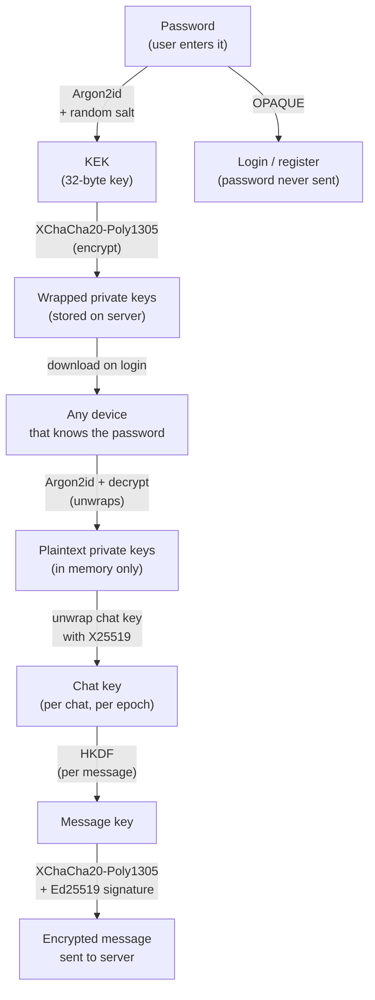

## TOTP encryption key

Optional TOTP two-factor authentication stores its secret and recovery-code
hashes in an AES-256-GCM encrypted vault in PostgreSQL. The encryption key is
`TOTP_ENCRYPTION_KEY`, encoded as base64 and decoding to exactly 32 random
bytes. It is separate from the OPAQUE server key and must be kept in the
deployment's secret manager, backed up securely, and never committed.

Changing or losing this key makes existing TOTP enrollments undecryptable.
Keep the key stable while any account has TOTP enabled. A key rotation requires
decrypting and re-encrypting every enrolled vault before replacing the old key.