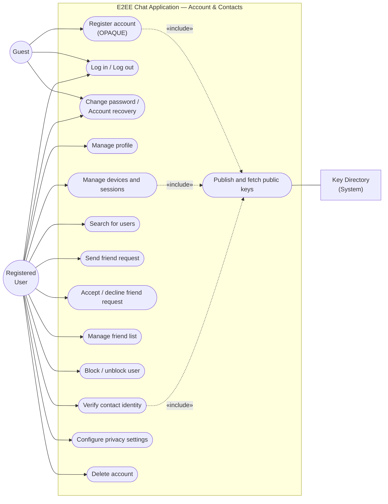
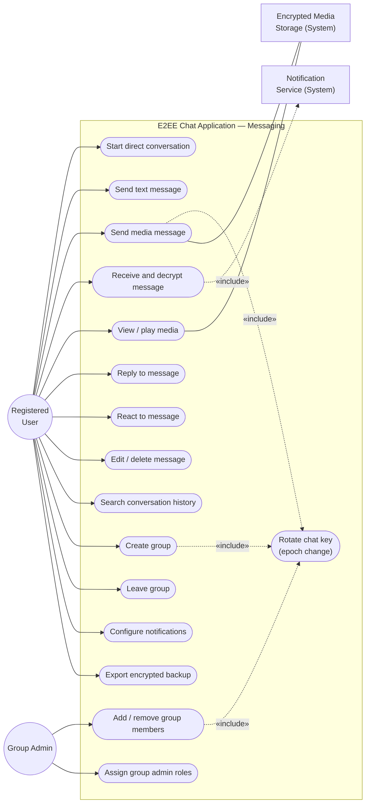

# Requirements Document
## End-to-End Encrypted Chat Application (Web)

## 1. Introduction

### 1.1 Purpose
This document specifies the requirements for a browser-based, end-to-end encrypted (E2EE) messaging application: the problem being solved, the target users, the product goal, and the functional and non-functional requirements the delivered system must satisfy, together with a use case diagram of the identified functionality.

It is the baseline for design, implementation, and acceptance testing. The cryptographic scheme is fixed in §5.2, and the requirements in this document reflect that scheme and its accepted trade-offs.

### 1.2 Scope
The system is a web application supporting account creation and authentication, session and device management, user discovery and contact management, end-to-end encrypted direct and group messaging with text, image/video, and audio messages, client-side search of locally decrypted message history, and encrypted media transport and storage.

---

## 2. Problem Description

### 2.1 Current Situation
Mainstream messaging platforms are centralised and encrypt data in transit and at rest, but the operator retains the ability to read message content, by design or through key escrow. Users who need confidential communication (journalists and sources, legal and medical professionals, activists, distributed engineering teams, privacy-conscious individuals) must choose between tools that are secure but difficult to use and weak on media sharing and group management, and tools that are convenient but require trusting the provider with plaintext-equivalent access. The convenient tools frequently also require a phone number as a primary identifier, force a single-device model, or offer weak or absent group key management.

### 2.2 Problems to be Solved

| # | Problem | Consequence |
|---|---|---|
| P1 | Message content is readable by the service operator | Confidential information is exposed to the provider, its employees, and anyone who compels or breaches it |
| P2 | Media sharing breaks the security model | Photos, videos, and audio are often uploaded unencrypted or re-encrypted server-side, defeating E2EE |
| P3 | Group E2EE is hard to get right | Membership changes, key rotation, and history access are frequently mishandled, leaving groups effectively unencrypted |
| P4 | Users cannot verify who they are talking to | Without identity verification, a malicious or coerced server can impersonate contacts (MITM) |
| P5 | Metadata is over-collected | Who talks to whom, when, and how often is itself sensitive |
| P6 | Existing secure tools have poor usability | Users abandon them or fall back to insecure channels |
| P7 | Onboarding requires a phone number | Excludes users without a number, and links a persistent real-world identifier to the account |
| P8 | Passwords are commonly sent to the server | Server-side password verification exposes credentials to breach, replay, and offline cracking |

### 2.3 Proposed Solution
A web application that performs all encryption and decryption on the client, uses the server purely as an untrusted relay, encrypted blob store, and key directory, provides first-class support for text and media in both DMs and groups, and gives users verifiable control over their identity and contacts. Password authentication is performed via OPAQUE so that the password never leaves the client.

---

## 3. Users and User Categories

### 3.1 User Categories

| Category | Description | Primary needs | Access level |
|---|---|---|---|
| **Guest / Visitor** | An unauthenticated person who has not yet created an account. | Understand what the product does; register or log in. | Public landing and auth pages only. |
| **Registered User** | An authenticated individual with a verified session on one or more devices. The primary actor of the system. | Communicate privately; manage contacts, devices, and settings. | All user-facing features within their own account. |
| **Group Admin** | A Registered User who holds elevated rights within a specific group (a **specialisation** of Registered User). | Control membership and roles; keep the group's key material consistent. | Group-scoped elevated permissions. |
| **Group Member** | A Registered User participating in a group without admin rights. | Participate in the conversation; leave when desired. | Read/write within the group; no membership management. |
| **System Administrator (Operator)** | Internal staff operating the service. | Keep the service running, healthy, and abuse-free. | Infrastructure-level access. **Cannot read message content or plaintext private keys.** |
| **Secondary / External Systems** | Supporting actors: Key Directory, Encrypted Media Storage, Notification Service, Email Service. | Interoperate with the application. | Programmatic interfaces. |

### 3.2 Representative User Profiles

| Profile | Description |
|---|---|
| **U1 — Investigative journalist** | Exchanges sensitive material with sources over long periods. Needs DM and small-group E2EE, audio/video attachments, out-of-band identity verification, and confidence that deleted messages are really removed. Laptop browser, occasionally mobile. |
| **U2 — Privacy-conscious professional** | Wants a messenger that requires no phone number and does not train on his data. Values simple onboarding and reliable push notifications; low tolerance for cryptographic jargon. |
| **U3 — Team lead at a distributed company** | Runs a 12-person project group. Needs to add and remove members, assign admins, and be certain that removed members cannot read new messages. Shares files and screen recordings in the group. |
| **U4 — Security reviewer** | Evaluates whether to recommend the tool. Cares about the threat model, key management, metadata handling, and the accepted trade-offs, notably the absence of forward secrecy. |
| **U5 — Operator / on-call engineer** | Needs observability, rate limiting, and abuse controls, but must not require or be able to obtain plaintext access. |

### 3.3 Assumptions About Users
- Users have a modern evergreen browser with JavaScript, `WebCrypto` (or a WASM fallback for primitives WebCrypto does not expose), and `IndexedDB`/`localStorage` available.
- Users understand that losing all devices *and* the account password means losing the ability to decrypt their encrypted private keys, and therefore their message history.
- Users accept that the server observes some metadata (account existence, connection times, ciphertext sizes, group membership, who-talks-to-whom) and that the scheme provides **no forward secrecy**: compromise of a chat key exposes every message encrypted under that epoch.

---

## 4. Product Goal

> **Product Goal:** Deliver a browser-based messaging application that lets individuals and small groups exchange text, image, video, and audio messages with true end-to-end encryption, where the service operator can never read user content or plaintext private keys, while keeping the everyday experience (onboarding, finding people, sending a message, sharing a file) simple enough that non-technical users adopt it without training.

**Goal decomposition**

| ID | Sub-goal | Success indicator |
|---|---|---|
| G1 | Confidentiality by design | All message payloads and media blobs are encrypted client-side; server-side plaintext of content or private keys is architecturally impossible |
| G2 | Complete messaging experience | Text, image, video, and audio supported in both DMs and groups |
| G3 | Usable security | A new user can register, add a friend, and send an encrypted message in under 3 minutes without documentation |
| G4 | Trustworthy identity | Every conversation offers an out-of-band verifiable safety number |
| G5 | Metadata minimisation | Only the metadata strictly required for delivery is retained; no content-derived analytics |
| G6 | Safe key handling on the server | Private keys are stored only in ciphertext, wrapped with Argon2id-derived keys; the server can never decrypt them |

---

## 5. Functional Requirements

Priority key: **M** = Must have, **S** = Should have, **C** = Could have.

### 5.1 Account and Authentication

| ID | Requirement | Priority |
|---|---|---|
| FR-AUTH-01 | A guest shall be able to register with an email address and password, or via an OAuth provider. A phone number shall never be required. Registration shall use OPAQUE: the password shall never leave the client, and the server shall store only a registration record and verifier. | M |
| FR-AUTH-02 | The system shall verify the email address before granting full account access. | M |
| FR-AUTH-03 | A registered user shall be able to log in using OPAQUE, and log out. On successful login the server shall issue a short-lived bearer token (JWT or opaque) and a rotating refresh token bound to the device. | M |
| FR-AUTH-04 | The system shall support optional TOTP-based two-factor authentication layered on top of OPAQUE. | S |
| FR-AUTH-05 | A user shall be able to change their password. Because the account password is used to derive the key that wraps the user's private keys, the client shall re-wrap the private keys with the new password-derived key during the change. Server-side password **reset** (forgotten password) shall be supported only through an explicit account-recovery flow that the user opts into, and shall be documented as either regenerating the identity or restoring from user-held recovery material. | M |
| FR-AUTH-06 | The system shall lock or rate-limit an account after repeated failed login attempts. | M |
| FR-AUTH-07 | A user shall be able to view all active sessions/devices and remotely revoke any of them. | M |
| FR-AUTH-08 | A user shall be able to permanently delete their account, which shall delete their ciphertext, blobs, wrapped private keys, and key-directory entries. | M |
| FR-AUTH-09 | A user shall be able to update their display name, avatar, and status message. | S |

### 5.2 Cryptography and Key Management

The scheme below is the agreed design for v1. Requirements in this section are normative for the implementation.

| ID | Requirement | Priority |
|---|---|---|
| FR-KEY-01 | All message content and media shall be encrypted and decrypted exclusively on the client. The server shall never hold message plaintext, media plaintext, or plaintext private keys. | M |
| FR-KEY-02 | On registration the client shall generate an **X25519** key pair (for key agreement) and an **Ed25519** key pair (for signing). Private keys shall never leave the client in plaintext. | M |
| FR-KEY-03 | The client shall encrypt the private keys with **XChaCha20-Poly1305** using a key derived from the user's password via **Argon2id**. The resulting ciphertext shall be uploaded to the server for storage and downloaded at login. | M |
| FR-KEY-04 | The client shall publish its public X25519 and Ed25519 keys to the key directory, and shall fetch other users' public keys from it. | M |
| FR-KEY-05 | Each chat (DM or group) shall have a random **256-bit ChaCha20-Poly1305 chat key**. On every membership change the chat key shall be rotated and the **epoch identifier** shall be incremented. | M |
| FR-KEY-06 | The chat key for the current epoch shall be encrypted to each member's X25519 public key and stored per member on the server, so that members can fetch and unwrap it. The server shall never hold the plaintext chat key. | M |
| FR-KEY-07 | Per-message keys shall be derived on the client as `HKDF(chat_key, epoch_id, message_id, sender_id)`. Message payloads shall be encrypted with **XChaCha20-Poly1305**. | M |
| FR-KEY-08 | Each encrypted message shall be signed with the sender's **Ed25519** private key and verified by recipients against the sender's published Ed25519 public key. | M |
| FR-KEY-09 | The AEAD **associated data** shall bind the ciphertext to `chat_id`, `epoch_id`, `message_id`, and `sender_id`, so that messages cannot be replayed into another chat, epoch, or identity. | M |
| FR-KEY-10 | The client shall display a safety number derived from a contact's public identity keys and support out-of-band verification, flagging unverified and changed-key states to the user. | M |
| FR-KEY-11 | Removed group members shall not be able to decrypt messages sent in any epoch created after their removal. The server shall not deliver post-removal chat keys to them. | M |
| FR-KEY-12 | **Forward secrecy is explicitly not provided** in v1. The design shall document this trade-off, and the client shall surface it in the privacy summary (see FR-PRV-05). | M |
| FR-KEY-13 | The system shall perform chat-key rotation on a defined schedule in addition to membership-change events. | S |
| FR-KEY-14 | The client shall support linking a new device such that the new device obtains the necessary key material from an existing trusted device rather than from the server alone. | S |
| FR-KEY-15 | Private keys shall be zeroed from client memory as soon as they are no longer needed for the active session. | S |

### 5.3 User Discovery and Contacts

| ID | Requirement | Priority |
|---|---|---|
| FR-CON-01 | A user shall be able to search for other users by exact username/handle, and optionally by email if that user has opted in to email discoverability. | M |
| FR-CON-02 | A user shall be able to send a friend request to another user. | M |
| FR-CON-03 | A recipient shall be able to accept or decline a friend request; a declined request shall not reveal the decision beyond "not connected". | M |
| FR-CON-04 | A user shall be able to view, search, and organise their friend list. | M |
| FR-CON-05 | A user shall be able to remove a friend and to block a user. A blocked user shall not be able to send messages, requests, or see presence. | M |
| FR-CON-06 | A user shall be able to set a handle and control whether they are discoverable by handle, by email, or not at all. | S |
| FR-CON-07 | The system shall prevent unsolicited message delivery from non-friends (message requests or an equivalent gate). | M |
| FR-CON-08 | A user shall be able to create local, client-side labels/groups of contacts. | C |

### 5.4 Direct Messaging

| ID | Requirement | Priority |
|---|---|---|
| FR-DM-01 | A user shall be able to start a direct conversation with any user in their friend list. Starting a conversation shall generate a random chat key, wrap it to both participants' X25519 public keys, and store the wrapped key per member on the server. | M |
| FR-DM-02 | A user shall be able to send a text message in a direct conversation, encrypted end-to-end with the scheme in §5.2. | M |
| FR-DM-03 | A user shall be able to send image, video, and audio/voice-note messages, encrypted end-to-end. | M |
| FR-DM-04 | A recipient shall be able to view images, play video, and play audio messages after client-side decryption and signature verification. | M |
| FR-DM-05 | A user shall be able to see delivery and read state for their own messages, subject to the recipient's privacy settings. | S |
| FR-DM-06 | A user shall be able to reply to a specific message (threaded quote). | S |
| FR-DM-07 | A user shall be able to react to a message with an emoji. | C |
| FR-DM-08 | A user shall be able to edit their own sent message within a configurable window; edits shall be propagated and marked as edited. | C |
| FR-DM-09 | A user shall be able to delete a message for themselves and, where supported, for all participants ("delete for everyone"). | S |
| FR-DM-10 | A user shall be able to delete an entire conversation from their own device. | S |
| FR-DM-11 | The conversation view shall show a chronological, paginated message history, including offline-queued messages once delivered. | M |
| FR-DM-12 | The client shall indicate message status: sending, sent, delivered, read, failed. | S |
| FR-DM-13 | A user shall be able to search the message history of their own conversations; search shall be performed client-side over decrypted local data. | S |
| FR-DM-14 | The client shall support typing indicators and presence, each individually disableable by the user. | C |
| FR-DM-15 | A user shall be able to send a "disappearing" message that is deleted from all clients after a chosen TTL. | C |

### 5.5 Group Messaging

| ID | Requirement | Priority |
|---|---|---|
| FR-GRP-01 | A user shall be able to create a group, giving it a name and an optional avatar, and selecting initial members from their friend list. Creating the group shall generate a random chat key at epoch 1 and wrap it to every member's X25519 public key. | M |
| FR-GRP-02 | A group admin shall be able to add members, where the added member is a friend of the admin. Adding a member shall increment the epoch, generate a fresh chat key, and wrap it to all current members including the new one. | M |
| FR-GRP-03 | A group admin shall be able to remove a member. Removing a member shall increment the epoch, generate a fresh chat key, and wrap it to the remaining members only, so that the removed member cannot decrypt messages in any subsequent epoch. | M |
| FR-GRP-04 | A group admin shall be able to promote or demote members between admin and member roles. | S |
| FR-GRP-05 | Any group member shall be able to leave a group voluntarily; leaving shall be treated as a membership change and shall trigger epoch rotation. | M |
| FR-GRP-06 | The system shall distribute and rotate the group chat key on every membership change, storing the new wrapped key per member on the server. | M |
| FR-GRP-07 | Members shall be able to send text, image, video, and audio messages to a group, encrypted end-to-end with the current epoch's chat key. | M |
| FR-GRP-08 | The system shall show a system message in the group timeline for membership and role changes. | S |
| FR-GRP-09 | A group admin shall be able to rename the group, change its avatar, and update its description. Group name and avatar shall be encrypted client-side before storage. | S |
| FR-GRP-10 | A group admin shall be able to configure whether new members can read history sent before they joined. Default: no. Enabling history access requires re-wrapping the relevant historical epoch keys to the new member. | S |
| FR-GRP-11 | The system shall support groups of at least 250 members. | S |
| FR-GRP-12 | A group shall be able to have more than one admin. | S |
| FR-GRP-13 | Group members shall be able to see the current member list with roles. | M |

### 5.6 Media Handling

| ID | Requirement | Priority |
|---|---|---|
| FR-MED-01 | The client shall generate a per-file random 256-bit key, encrypt the file with **XChaCha20-Poly1305** before upload, and upload only the ciphertext. | M |
| FR-MED-02 | The client shall transmit the per-file key and nonce to recipients inside the E2EE message payload (encrypted under the per-message key from §5.2), never to the server. | M |
| FR-MED-03 | The system shall enforce a maximum attachment size and shall communicate it to the user before upload. | M |
| FR-MED-04 | The client shall support common image (JPEG, PNG, WebP, GIF), video (MP4, WebM), and audio (WebM/Opus, MP3, M4A) formats. | M |
| FR-MED-05 | The client shall show upload/download progress and allow cancellation. | S |
| FR-MED-06 | The client shall generate encrypted thumbnail previews so media can be previewed without downloading the full file. | S |
| FR-MED-07 | The client shall support in-browser audio recording for voice notes. | S |
| FR-MED-08 | The server shall store encrypted blobs with no plaintext filename, no plaintext content type, and randomised object identifiers. | M |
| FR-MED-09 | The system shall automatically expire unreferenced blobs and blobs belonging to deleted messages/accounts. | S |

### 5.7 Notifications, Presence, and Sync

| ID | Requirement | Priority |
|---|---|---|
| FR-NOT-01 | The system shall deliver messages to online clients over a persistent bidirectional connection. | M |
| FR-NOT-02 | The system shall queue messages for offline recipients and deliver them on reconnect. | M |
| FR-NOT-03 | The system shall send Web Push notifications for new messages when the client is not active. Notification content shall not include message plaintext by default. | S |
| FR-NOT-04 | A user shall be able to mute notifications per conversation. | S |
| FR-NOT-05 | The system shall synchronise message state across a user's linked devices. | S |
| FR-NOT-06 | The system shall resolve ordering conflicts deterministically using client-generated timestamps and server-assigned sequence numbers. | M |

### 5.8 Privacy, Safety, and Account Controls

| ID | Requirement | Priority |
|---|---|---|
| FR-PRV-01 | A user shall be able to control read receipts, typing indicators, presence, and last-seen visibility. | S |
| FR-PRV-02 | A user shall be able to export an encrypted backup of their conversations that only they can decrypt. | C |
| FR-PRV-03 | A user shall be able to see and revoke any pending or active friend request. | S |
| FR-PRV-04 | The system shall provide a mechanism for reporting abuse that does not require the server to read message content (e.g. client-side forwarding of selected messages to a reviewer). | C |
| FR-PRV-05 | The system shall display a plain-language privacy summary describing exactly what the server can and cannot see, including the absence of forward secrecy and the metadata that the server necessarily observes. | M |
| FR-PRV-06 | A user shall be able to clear all locally cached plaintext (messages, decrypted keys, media) from a device. | M |

### 5.9 Administration (Operator)

| ID | Requirement | Priority |
|---|---|---|
| FR-ADM-01 | An operator shall be able to monitor service health, connection counts, and queue depths. | M |
| FR-ADM-02 | An operator shall be able to rate-limit and suspend accounts exhibiting abusive traffic patterns (spam, flooding). | M |
| FR-ADM-03 | An operator shall be able to force chat-key rotation and session invalidation globally in response to an incident. | S |
| FR-ADM-04 | Administrative interfaces shall never expose message plaintext or plaintext private keys, and shall be audited. | M |

---

## 6. Non-Functional Requirements

### 6.1 Security

| ID | Requirement |
|---|---|
| NFR-SEC-01 | The server shall never have access to message plaintext, media plaintext, or plaintext private keys, at any point in the request lifecycle, including logging, debugging, and backup. |
| NFR-SEC-02 | Cryptographic primitives shall be: **OPAQUE** for password authentication; **X25519** for key agreement; **Ed25519** for signatures; **XChaCha20-Poly1305** for symmetric encryption of messages, chat keys, media, and wrapped private keys; **HKDF-SHA256** for per-message key derivation; **Argon2id** for password-based key derivation. |
| NFR-SEC-03 | All client-server transport shall use TLS 1.3 (TLS 1.2 minimum) with HSTS. |
| NFR-SEC-04 | The protocol **does not provide forward secrecy or post-compromise security**; this is an accepted trade-off (see FR-KEY-12). No documentation, marketing, or UI copy shall claim otherwise. |
| NFR-SEC-05 | The protocol shall resist replay, reordering, and message forgery: AEAD associated data shall bind each ciphertext to `chat_id`, `epoch_id`, `message_id`, and `sender_id`, and every message shall carry an Ed25519 signature verified by recipients. |
| NFR-SEC-06 | Authentication tokens shall be short-lived, rotated, and bound to a device; refresh tokens shall be revocable. |
| NFR-SEC-07 | The client shall be served over a strict Content Security Policy with Subresource Integrity for all third-party assets, and shall be protected against XSS, CSRF, SQL injection, SSRF, and clickjacking using standard mitigations. |
| NFR-SEC-08 | Any change to a contact's public identity key shall be surfaced prominently to the user before messages are sent. |
| NFR-SEC-09 | The codebase shall undergo at least one independent third-party security review before general availability, and the cryptographic protocol shall be publicly documented, including its limitations. |

### 6.2 Privacy and Compliance

| ID | Requirement |
|---|---|
| NFR-PRV-01 | Only metadata strictly required for delivery shall be retained: account identifier, ciphertext size, server timestamps, recipient routing identifiers, and group membership. |
| NFR-PRV-02 | Message content shall not be used for analytics, advertising, or model training. |
| NFR-PRV-03 | Data retention periods shall be documented and enforced, with automatic deletion of expired ciphertext and blobs; IP addresses shall not be retained in application logs beyond the operational minimum, and shall be truncated or hashed where feasible. |
| NFR-PRV-04 | The system shall support GDPR-style data subject rights (access, portability, erasure) for the metadata and ciphertext it holds. |
| NFR-PRV-05 | The privacy summary presented to users shall explicitly state that the server observes who talks to whom, when, group membership, and message sizes. |

### 6.3 Performance and Scalability

| ID | Requirement |
|---|---|
| NFR-PERF-01 | Message delivery latency (sender send to recipient receive) shall be under 500 ms at the 95th percentile within a single region. |
| NFR-PERF-02 | Initial application load (first meaningful paint) shall be under 2 seconds on a 4G connection with a mid-range device. |
| NFR-PERF-03 | The client shall render a conversation with 10,000 cached messages without dropping below 30 FPS during scrolling (virtualised list). |
| NFR-PERF-04 | Client-side Argon2id derivation at login shall complete within 3 seconds on a mid-range mobile device at the configured parameters. |
| NFR-SCAL-01 | The system shall support at least 100,000 concurrently connected clients in a horizontally scaled deployment, with linear scaling demonstrated to 500,000. |
| NFR-SCAL-02 | The message relay shall scale horizontally with no single point of failure, using consistent hashing or a shared pub/sub backplane for cross-node delivery; media storage shall scale independently of the relay tier. |

### 6.4 Reliability and Availability

| ID | Requirement |
|---|---|
| NFR-AVL-01 | The service shall target 99.9% monthly availability for the messaging path (excluding scheduled maintenance windows announced in advance). |
| NFR-AVL-02 | Message relay shall guarantee at-least-once delivery; the client shall deduplicate by message ID. |
| NFR-AVL-03 | The system shall survive the loss of any single relay node, and recover from a full relay-tier restart within 5 minutes, without acknowledged message loss. |
| NFR-AVL-04 | The client shall degrade gracefully when offline: queueing outgoing messages and clearly indicating connection state. |

### 6.5 Usability and Accessibility

| ID | Requirement |
|---|---|
| NFR-USE-01 | A new user shall be able to register, find a friend, and exchange a first encrypted message in under 3 minutes without external documentation. |
| NFR-USE-02 | Cryptographic states (encrypted, verified, unverified, key changed) shall be communicated in plain language with a consistent visual indicator. |
| NFR-USE-03 | The interface shall be responsive and fully functional on viewports from 360 px to 2560 px wide, shall meet WCAG 2.1 Level AA (including full keyboard navigation, visible focus states, and screen-reader-compatible semantics for the message list and composer), and shall support light and dark themes, respecting the OS preference. |
| NFR-USE-04 | The interface shall be internationalised, with all user-facing strings externalised and RTL layout support. |

### 6.6 Compatibility and Portability

| ID | Requirement |
|---|---|
| NFR-CMP-01 | The application shall support the current and previous major versions of Chrome, Firefox, Safari, and Edge, on both desktop and mobile, and shall require no browser extensions, plug-ins, or native installs. |
| NFR-CMP-02 | Where WebCrypto lacks a required primitive (notably XChaCha20-Poly1305 and OPAQUE), a vetted WASM implementation shall be used. All primitives shall be provided by audited, well-maintained libraries. |
| NFR-CMP-03 | The service shall be deployable as container images on any major cloud provider or on-premise Kubernetes cluster. |

### 6.7 Maintainability, Testability, and Operability

| ID | Requirement |
|---|---|
| NFR-MNT-01 | The codebase shall be split into clearly separated client, protocol, and server modules, with the protocol defined by a versioned, published specification. |
| NFR-MNT-02 | Automated tests shall cover at least 80% of the protocol/crypto module and all critical user flows end to end, including known-answer tests for the OPAQUE, HKDF, and AEAD constructions. |
| NFR-MNT-03 | CI shall run linting, unit tests, integration tests, and dependency vulnerability scanning on every pull request. |
| NFR-MNT-04 | The system shall expose structured logs, metrics, and traces; logs shall never contain plaintext, keys, or tokens. |
| NFR-MNT-05 | The protocol shall be versioned and support backward-compatible upgrades so clients are not forced to update simultaneously. |

---

## 7. Use Case Diagram

### 7.1 Actors

| Actor | Type | Notes |
|---|---|---|
| Guest | Primary | Unauthenticated visitor |
| Registered User | Primary | The main actor |
| Group Admin | Primary | Specialisation of Registered User (scoped to a group) |
| Key Directory | Secondary (system) | Stores public identity keys and per-member wrapped chat keys |
| Encrypted Media Storage | Secondary (system) | Stores encrypted blobs |
| Notification Service | Secondary (system) | Web Push delivery |
| System Administrator | Primary (internal) | Operates the service; no content access |

### 7.2 Diagram A — Account, Identity, and Contacts

### 7.3 Diagram B — Messaging, Media, and Groups

> **Notation notes.** `Group Admin` is a specialisation of `Registered User`: every use case available to a Registered User is also available to a Group Admin. `«include»` denotes functionality that is always executed as part of the base use case. Secondary actors (Key Directory, Media Storage, Notification Service) participate programmatically and are not human users.

---

## 8. Constraints and Dependencies

| ID | Constraint / Dependency |
|---|---|
| C-01 | The client must run in a browser and therefore depends on the WebCrypto API and browser storage quotas (IndexedDB). Some primitives (XChaCha20-Poly1305, OPAQUE) require a vetted WASM implementation. |
| C-02 | The threat model excludes a fully compromised client device (malware, keyloggers). |
| C-03 | The server is treated as untrusted for confidentiality but trusted for availability and correct routing. |
| C-04 | Metadata (account existence, connection times, ciphertext sizes, recipient sets, group membership) is necessarily visible to the server; the design minimises, not eliminates, it. |
| C-05 | The account password is required to unwrap the encrypted private keys. Losing the password without user-held recovery material means losing the ability to decrypt message history. This must be communicated clearly. |
| C-06 | The scheme does not provide forward secrecy (see FR-KEY-12). Any future introduction of forward secrecy will require a protocol version bump and migration plan. |
| C-07 | Media storage costs scale with ciphertext volume and require a retention/expiry policy. |
| C-08 | All cryptographic primitives must be provided by audited, well-maintained libraries (e.g. libsodium, an audited OPAQUE implementation). |
| C-09 | Regulatory obligations in target markets may impose lawful-access requests; the architecture makes content disclosure impossible rather than merely refused. |

---

## 9. Out of Scope (v1)

- Voice and video calling (WebRTC).
- Native iOS/Android/desktop clients.
- Federation between independently operated servers.
- Public channels, broadcast lists, or communities above 250 members.
- Bot platform, webhooks, and third-party integrations.
- Server-side message translation or any content-processing feature.
- Message export to plaintext formats.
- Payments or monetisation features.
- Forward secrecy and post-compromise security (FR-KEY-12).
- Sealed sender / metadata-hiding routing.

---

## 10. Glossary

| Term | Meaning |
|---|---|
| **AEAD** | Authenticated Encryption with Associated Data. |
| **Argon2id** | Memory-hard password-based key derivation function (RFC 9106). |
| **Blob** | An encrypted, opaque media object held by the server. |
| **Chat key** | The random 256-bit symmetric key protecting a chat during one epoch. |
| **Epoch** | A version of the chat key. Increments on every membership change. |
| **Ed25519** | A digital signature scheme used for message and control-message authenticity. |
| **HKDF** | HMAC-based Key Derivation Function (RFC 5869). |
| **OPAQUE** | An augmented password-authenticated key exchange (aPAKE) where the password never leaves the client. |
| **Safety number** | A fingerprint of a user's public identity keys, compared out of band to detect impersonation. |
| **Threat model** | The explicit statement of which adversaries the system defends against. |
| **Verifier** | The server-side record in OPAQUE that allows login to be verified without the server learning the password. |
| **X25519** | An elliptic-curve Diffie-Hellman function used for key agreement. |
| **XChaCha20-Poly1305** | An extended-nonce AEAD cipher. |

---
